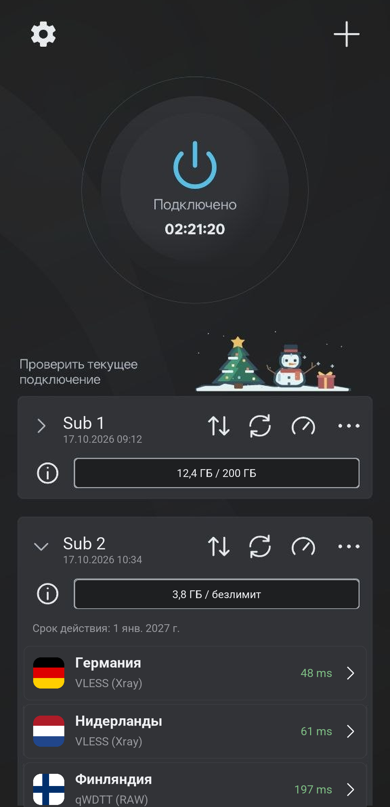
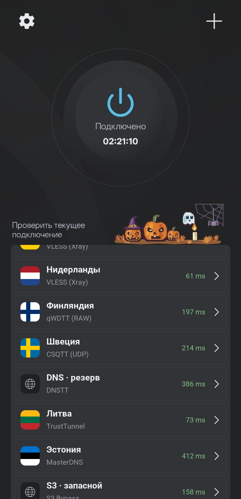

# qThroneMobile

Android-клиент на ядрах [sing-box](https://github.com/SagerNet/sing-box) и [Xray](https://github.com/XTLS/Xray-core). Форк [ThroneForAndroid](https://github.com/throneproj/ThroneForAndroid).

Помимо стандартных протоколов sing-box и Xray поддерживает qWDTT, CSQTT, olcRTC, OpenFlux, DNSTT, VayDNS, SlipStream, MasterDNS и S3 Bypass - с подписками, тестом пинга и раздельной маршрутизацией.

  
  &nbsp;&nbsp;
  

## Скачать

Свежий APK - в [Releases](https://github.com/ttrroyy/qThroneMobile/releases/latest). Нужен Android 7.0 или новее; сборки есть для arm64-v8a, armeabi-v7a и x86_64. Приложение само сообщает о новых версиях.

## Особенности

**Новые протоколы.** qWDTT, CSQTT, olcRTC, OpenFlux, DNS-туннели и S3 Bypass запускаются через оригинальные клиенты этих проектов. Работают как обычные профили: с маршрутизацией, цепочками и тестом пинга.

**Привязка аккаунта VK.** Хеши звонков для qWDTT и CSQTT можно получать автоматически.

**Деплой сервера.** Сервер qWDTT или CSQTT можно развернуть на VPS по SSH прямо из приложения и сразу получить ссылку на профиль. Подробнее - в [docs/vk-relay-deployment.md](docs/vk-relay-deployment.md).

## Протоколы

| Тип | Протоколы |
|---|---|
| Стандартные | VLESS, VMess, Trojan, Shadowsocks, SOCKS, HTTP(S), SSH |
| QUIC | Hysteria, Hysteria2, TUIC, MASQUE |
| VPN | WireGuard, AmneziaWG, OpenVPN, OpenConnect |
| Другие прокси | ShadowTLS, NaïveProxy, AnyTLS, Mieru, Snell, Juicity, TrustTunnel |
| VK и WebRTC | qWDTT, CSQTT, olcRTC, OpenFlux |
| DNS-туннели | DNSTT, VayDNS, SlipStream, MasterDNS |
| S3-хранилище | S3 Bypass |

Также поддерживаются пользовательские outbound, полные конфиги sing-box и Xray, цепочки прокси и дополнительные ядра.

## Как добавить профиль

Кнопка «+» на главном экране: из буфера обмена, по QR-коду, из файла, по ссылке на подписку или вручную. Понимает ссылки всех перечисленных протоколов - в том числе `qwdtt://`, `csqtt://`, `olcrtc://`, `openflux://`, `dnst://`, `slipnet://` и `masterdns://`, - а также JSON-конфиги sing-box и Xray (S3 Bypass импортируется из Xray-конфига с outbound `fedarisha`).

## Сборка

APK собирает CI: [`.github/workflows/ci.yml`](.github/workflows/ci.yml), шаги - в [`.github/actions/android-build`](.github/actions/android-build). Нативные клиенты протоколов собираются отдельно ([`carriers.yml`](.github/workflows/carriers.yml)) из закреплённых коммитов оригинальных репозиториев; их архивы и контрольные суммы записаны в [`native-transports.lock.json`](native-transports.lock.json), а `scripts/stage_native_transports.py` скачивает и проверяет их перед сборкой.

## Лицензия

[GPL-3.0](LICENSE). У клиентов сторонних протоколов свои лицензии - они лежат в приложении рядом с бинарниками (`assets/carrier-licenses`).

## Поддержать проект

Понравилось - ставь ⭐ репозиторию: это помогает другим найти проект.

Поддержать разработку монеткой:

| Сеть | Адрес |
|---|---|
|  | `TL22P1n3JmVkhYU8RyMXfRUURx4PN6h4WZ` |
|  | `0x0B7e9f024e92f7333AB9146c0351732B959D4e9A` |
|  | `bc1qw5larutup50tdk4vuskdzep5r9ydyzt4g0c6dm` |
|  | `UQBFy4FDUovKADmWYNumVFsfgKNvI3uuzPy34fHd3sEI1R86` |
